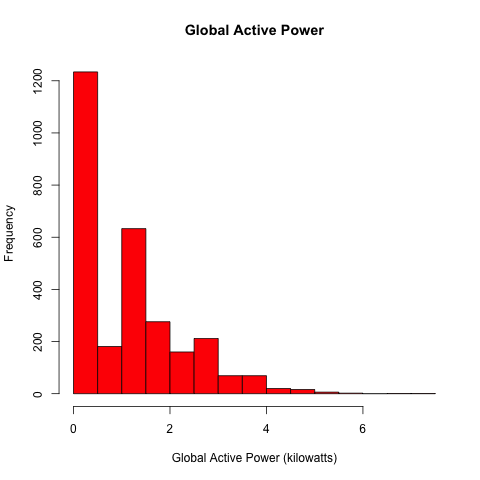
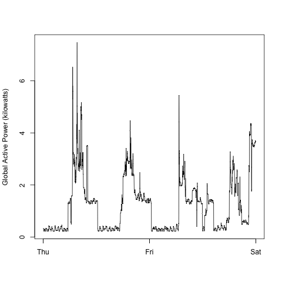
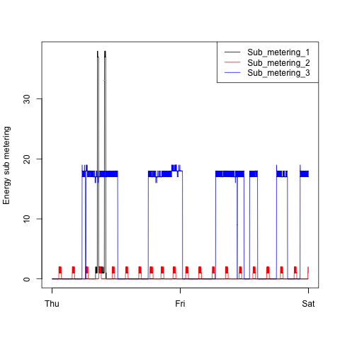
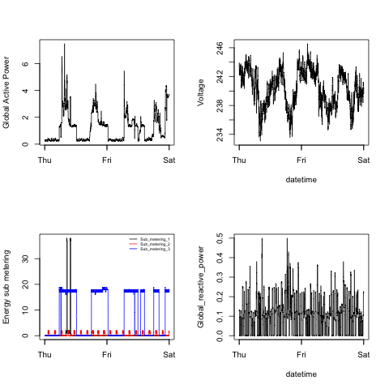

# Household Power Consumption: Exploratory Analysis

Four reproducible R visualizations of household electricity consumption during February 1–2, 2007.

## Question

How do total active power, voltage, reactive power, and three sub-metering channels change over two days?

## Data

- **Source:** [UCI Machine Learning Repository — Individual Household Electric Power Consumption](https://archive.ics.uci.edu/dataset/235/individual+household+electric+power+consumption)
- **Original scope:** one-minute measurements collected over almost four years
- **Analysis window:** February 1–2, 2007

The scripts download the source archive when it is not already present. Raw data are excluded from version control.

## Results

| Distribution | Active power over time |
|---|---|
|  |  |

| Sub-metering channels | Combined four-panel view |
|---|---|
|  |  |

## Reproduce

Run from the repository root with R and the `data.table` package installed:

```r
source("Plot1.R")
source("plot2.R")
source("plot3.R")
source("plot4.R")
```

`load_data.R` performs the shared download, parsing, and date filtering so each chart script remains focused on its visual.

## Author

**Jhon Deiner Diaz** · [Full data portfolio](https://jhon1217.github.io/jhu-data-science-projects/)
